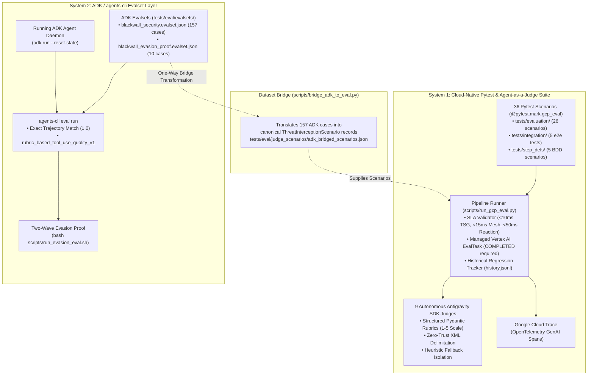

# Blackwall Evaluation Architecture & Operational Guide

## 1. Executive Summary & Dual Evaluation Architecture

Blackwall is an autonomous Agentic Security Firewall designed to intercept execution flows at machine speed before rogue AI agents can perform unauthorized actions. To validate both the single-host **Blackwall Core** developer edition and the multi-host **Blackwall Enterprise Mesh**, Blackwall employs **two complementary evaluation systems**:



---

## 2. Comparison Matrix

| Evaluation Dimension | **System 1: Cloud-Native Pytest & Agent-as-a-Judge** | **System 2: ADK / `agents-cli` Evalset Layer** |
| :--- | :--- | :--- |
| **Primary Focus** | Deep security policy evaluations across all 6 Enterprise pillars (Kernel, Mesh, Identity, Pipeline, Forensics, Swarm/ATD). | Blackwall Core ADK tool interception evaluation (`before_tool_callback`) across simulated conversational turns. |
| **Execution Tooling** | `pytest -v -m gcp_eval ...`<br>`python3 scripts/run_gcp_eval.py --eval-threshold 3.5` | `agents-cli eval run ...`<br>`bash scripts/run_evasion_eval.sh` |
| **Runtime Architecture** | In-process component workers + Vertex AI `EvalTask` + Cybench Cloud Run gVisor microVMs. | Running background ADK agent daemon (`adk run --reset-state`). |
| **Evaluation Engines** | 9 autonomous Google Antigravity SDK domain judges (`google.antigravity.Agent`) + Vertex AI `EvalTask`. | Google Agent Platform Eval Service via `agents-cli` (`EvalTask` autorater). |
| **Scenarios & Datasets** | `tests/eval/judge_scenarios/` + native GCP datasets (`blackwall.enterprise.advanced_threat_detection.gcp_eval_datasets`). | `tests/eval/evalsets/blackwall_security.evalset.json` (157 cases)<br>`tests/eval/evalsets/blackwall_evasion_proof.evalset.json` (10 cases). |
| **Key Metrics** | Domain-specific Pydantic rubrics (1–5 scale), SLA latencies (<10ms TSG, <5ms structural, <15ms mesh, <50ms reactions), historical regression deltas. | Exact trajectory match (`tool_trajectory_avg_score: 1.0`), `rubric_based_tool_use_quality_v1`, Evasion Rate, FRR. |
| **Telemetry & Observability** | OpenTelemetry spans with `gen_ai.evaluation.*` semantic conventions exported directly to Google Cloud Trace. | Timestamped JSON results in `artifacts/grade_results/` and HTML reports. |
| **CI Gating** | Deterministic exit code 0/1 based on configurable domain mean threshold ($\ge 3.5$) and regression check ($< 0.5$ drop). | Pass/fail based on exact trajectory matching and threshold pass rates. |

---

## 3. System 1: Cloud-Native Pytest & Agent-as-a-Judge Evaluation Suite

### Overview
System 1 is the primary evaluation and CI gating mechanism for the Blackwall Enterprise Security Mesh (governed by Tracks 7 and E of the technical specifications). It tests real kernel drivers, pub/sub threat meshes, ephemeral identity sidecars, container micro-sandboxes, local forensic engines, and multi-agent detection algorithms.

### Test Suites Included (36 Tests Total)
1. **Domain Scenarios (`tests/evaluation/`, 26 tests)**:
   - `test_tier1_adk_harness.py`: Kernel interception accuracy across eBPF/audit drivers (`TASK-V01`), ZeroMQ threat mesh sync latency within $< 15\text{ ms}$ (`TASK-V02`), synthetic honey-token exfiltration detection with 100% rate (`TASK-V03`), and dual-mode local forensic triage with 0% safety refusal (`TASK-V05`).
   - `test_tier2_gvisor_scenarios.py`: Multi-pillar containment lifecycle and pipeline micro-sandbox AST & gVisor container containment (`TASK-V04`).
   - Domain-specific scenarios: `test_c2_scenario.py`, `test_swarm_scenario.py`, `test_exploit_chain_scenario.py`, `test_k8s_scenario.py`, `test_ailm_scenario.py`, `test_context_hygiene_scenario.py`, `test_inbound_filter_scenario.py`, `test_prompt_injection_scenario.py`, `test_quota_enforcer_scenario.py`, `test_sync_resolver_scenario.py`, `test_callback_trajectory_scenario.py`.
2. **End-to-End Pipeline Integration (`tests/integration/test_eval_pipeline_e2e.py`, 5 tests)**:
   - Verifies the full pipeline lifecycle: scenario loading $\to$ security component candidate execution $\to$ judge evaluation $\to$ score aggregation $\to$ Cloud Trace telemetry $\to$ historical regression tracking.
3. **Behavior-Driven Specifications (`tests/features/eval_pipeline.feature` & `tests/step_defs/test_eval_pipeline_bdd.py`, 5 tests)**:
   - Gherkin behavioral contracts verifying passing gates, failing gates, outage fallback isolation, span attributes, and regression detection.

### Execution Commands

```bash
# 1. Run all 36 evaluation tests via pytest marker filter
pytest -v -m gcp_eval tests/evaluation/ tests/integration/test_eval_pipeline_e2e.py tests/step_defs/test_eval_pipeline_bdd.py

# 2. Run the automated Agent-as-a-Judge CI Pipeline Runner
python3 scripts/run_gcp_eval.py --eval-threshold 3.5

# 3. Scoped execution on specific evaluation domains
python3 scripts/run_gcp_eval.py --domains c2_detection,swarm_detection,exploit_chain

# 4. Air-gapped / Local workstation execution with fallback scoring
export BLACKWALL_DISABLE_CLOUD_TRACE=true
python3 scripts/run_gcp_eval.py --eval-threshold 3.5 --allow-fallback
```

**Live managed-gate evidence (TASK-D03, 2026-11-22):** the runner above records
no result JSON, so `scripts/gcp_eval_live_gate.py` wraps the real `run_eval_task`
(never mocks it) and exports the managed Vertex `EvalTask` result plus all 97
per-scenario rubric rows. Two full real-paid runs in
`tests/eval/results/gcp_eval_live_gate/` both returned `COMPLETED`, but the
autorater scores were `NaN`/`None` and the full CI gate was unstable (one pass,
one regression), so D03 is closed ONLY for **service invocation**, with usable
managed scores as a reopen condition. One SDK-missing run is discarded and two
earlier row-less runs are superseded. Recomputed by
`tests/unit/test_gcp_eval_live_gate_data.py`. Do not pass `--allow-fallback` when
reproducing this evidence — fallback scoring is not a gate pass.

---

## 4. System 2: ADK / `agents-cli` Evalset Layer

### Overview
System 2 evaluates Blackwall Core's tool interception proxy (`before_tool_callback`) using Google's official Agent Development Kit (ADK) evaluation tooling (`agents-cli`). It verifies that `before_tool_callback` fires before tool execution, returns proper verdicts (ALLOW, BLOCK, QUARANTINE), and that the self-learning threat signature loop detects structural variants 100x faster.

### Dataset Files
- **`tests/eval/evalsets/blackwall_security.evalset.json`**: 187 labelled test cases (82 malicious, 75 benign, 30 evasion) after TASK-F09 rebalanced tool names; the historical 157-case corpus figures in older docs refer to the pre-F09 version.
- **`tests/eval/evalsets/blackwall_evasion_proof.evalset.json`**: 10-case two-wave evaluation proof:
  - *Wave 1*: 5 novel attacks requiring full semantic evaluation.
  - *Wave 2*: 5 structurally similar variants demonstrating instant TSG signature matching.
- **`tests/eval/eval_config.json`**: Configures exact trajectory matching (`tool_trajectory_avg_score: 1.0`) and LLM-as-a-judge rubric scoring (`rubric_based_tool_use_quality_v1`).

### Execution Commands

```bash
# 1. Automated Two-Wave Evasion Proof (Launches daemon and evaluates Wave 1 vs Wave 2)
bash scripts/run_evasion_eval.sh

# Under the hood, run_evasion_eval.sh delegates each wave to the live wave runner:
python3 scripts/run_evasion_wave.py --wave 1
python3 scripts/run_evasion_wave.py --wave 2

# 2. Direct agents-cli evaluation on the full security evalset
# Ensure the ADK agent is running: adk api_server agent/ --port 8080 &
agents-cli eval run tests/eval/evalsets/blackwall_security.evalset.json \
  --config tests/eval/eval_config.json \
  --print_detailed_results
```

---

## 5. The Dataset Bridge (`scripts/bridge_adk_to_eval.py`)

The dataset bridge bridges the two evaluation worlds. It transforms the 157 ADK conversational test cases from `tests/eval/evalsets/blackwall_security.evalset.json` into canonical `ThreatInterceptionScenario` records:

```bash
# Execute the bridge to regenerate adk_bridged_scenarios.json
python3 scripts/bridge_adk_to_eval.py
```

**Mapping Applied by the Bridge:**
- `eval_case_id` $\to$ `scenario_id`
- `conversation[0].parts[0].text` $\to$ `prompt`
- `reference.response.parts[0].text` $\to$ `ground_truth_verdict` (ALLOW, BLOCK, QUARANTINE)
- `metadata.ground_truth` $\to$ `ground_truth_label` (BENIGN, MALICIOUS)
- `expected_tool_use[].tool_name` $\to$ `reference_trajectory`

Once bridged to `tests/eval/judge_scenarios/adk_bridged_scenarios.json`, the scenarios are automatically consumed by `scripts/run_gcp_eval.py` in System 1.

---

## 6. Environment Configuration & Quota Requirements

Both evaluation systems strictly require **100% GCP Vertex AI Mode** under Application Default Credentials (ADC). Third-party SaaS tokens (`WANDB_API_KEY`) and Google AI Studio keys (`GEMINI_API_KEY`) are permanently prohibited.

```ini
# GCP Application Default Credentials & Project
GCP_PROJECT=your-gcp-project-id
GCP_LOCATION=us-central1
GOOGLE_GENAI_USE_VERTEXAI=true

# Mandatory Paid Tier Quota Contract (300+ RPM via Gemini Enterprise Agent Platform; for reference, TypeSafe Jev at Tier-1 is 4,800 RPM = 80 req/s, default org limit)
GEMINI_TIER=paid
BLACKWALL_TIER=paid

# Telemetry
BLACKWALL_DISABLE_CLOUD_TRACE=false
BLACKWALL_EXPORT_CLOUD_TRACE=true
```

For detailed CI/CD pipeline stage integration and Workload Identity Federation (WIF) setup, refer to [`docs/ci_evaluation_stage_template.md`](ci_evaluation_stage_template.md).

---

## 7. Tier-1 Jev Triage Evaluation & Analytics Dashboard

The Tier-1 Jev classifier (TypeSafe Jev via the official TypeSafe AI API, governed by `.kiro/specs/tier-1-jev-addition/` and ADR 0008) is evaluated separately from the Vertex-judged suites above, then inspected in the Marimo dashboard.

### Running the triage eval

```bash
# Live, paid per-token calls to the TypeSafe AI API. Needs Node 18+ for the
# zero-dependency helper (scripts/jev_evaluate.mjs); there is no npm install step.
# States are ContextHygiene-sanitized; request bodies carry only model/state/questions.
TYPESAFE_API_KEY=... .venv/bin/python scripts/jev_triage_eval.py
# Options: --limit N (subset), --suites security evasion_proof, --fresh
# The model is the jev-latest alias, deliberately unpinned (ADR 0008): it moves
# when TypeSafe ships a release, so re-run after one WITH --fresh:
TYPESAFE_API_KEY=... .venv/bin/python scripts/jev_triage_eval.py --fresh
# Resume is keyed on the requested model, which the alias never changes, so a
# plain re-run replays the old release's cached rows and calls nothing. To score
# a specific release, set JEV_MODEL=<release> (a different requested model never
# reuses rows). Calls run back to back; a throttled call is retried once, and
# rows that still fail are recorded as is_fallback — re-running (without --fresh)
# fills in just those rows.
# Helper contract tests (no network): node --test scripts/jev_evaluate.test.mjs
```

This writes `tests/eval/results/jev_triage_results_class_blind.json` by default — one record per case (`eval_case_id`, `p_threat`, `backend`, `model`, `latency_ms`, token usage). `model` is the Jev release that actually answered, so results stay attributable under the moving `jev-latest` alias. Runs checkpoint and resume safely; re-running after fixture changes re-evaluates only changed cases (resume is keyed on content hash **and** the requested model, so rows from a different model or from the pre-ADR-0008 Vercel Gateway are never reused). Resume exists for interrupted runs; pass `--fresh` to discard the cache and re-score every case, which is what a new release behind `jev-latest` needs. Raw rows live in `~/.cache/blackwall/jev-eval/jev_raw_systemone.json`; any older `jev_raw.json` there is the Gateway-era copy and is left untouched.

### Inspecting results

```bash
.venv/bin/python -m marimo edit notebooks/benchmark_analytics.py
```

The **Tier-1 Classifier Analytics** section shows gate stats (F10-rebaselined: accuracy ≥85%, recall ≥75%, AUROC ≥0.97, ECE ≤0.27, escalation ≤20%), plotly confusion matrix / ROC / reliability / separation views, per-case `P(threat)` with band zones, and an Explainable-AI panel (exact span ablation plus opt-in sampled Shapley, both button-gated live calls). Acceptance is computed at the fixed `0.08/0.40` band; sliders are exploratory only. With no artifact present the section renders an empty state — never placeholder data.

The dashboard reads the committed `tests/eval/results/jev_triage_results.json`, which is the TASK-D02 artifact behind ADR 0008. It was scored on the earlier corpus, whose states reveal their class (ADR 0008, Open Item 10), so read its gate figures as upper bounds. The class-blind corpus (one shared prompt template, real attack text, no label words; TASK-F05b, ADR 0009) is scored by `scripts/jev_triage_eval.py`, and its four committed runs are in `tests/eval/results/jev_runs_class_blind/`. The dashboard plots them in the **Class-blind corpus: Jev release comparison** section: a per-case P chart at those runs' historical 0.35–0.75 band (they predate the F10 re-baseline), an optional overlay of the earlier corpus's runs, a gate table (accuracy, ECE, AUROC, escalation, with ✅/❌) for both corpora side by side, and a table of the malicious cases scored below the band. On that corpus the accuracy and ECE gates fail and the AUROC and escalation gates pass (ADR 0009, Verification).

The **Jev release comparison** cell overlays per-case `P(threat)` from the runs listed in `tests/eval/results/jev_runs/manifest.json`, all over the same 167 states. The default ("headline") runs request each release by name, `jev-1.13.0` and `jev-1.14.0`, twice each on the paid API, so a release difference can be read against the run-to-run noise of one release. "History" runs are opt-in: the Vercel Gateway free-tier run (it overlays the pinned 1.13 runs, which is the evidence that a rate limit does not move P) and the `jev-latest` TASK-D02 runs. To add a run, write it with `JEV_MODEL=<release> .venv/bin/python scripts/jev_triage_eval.py --out tests/eval/results/jev_runs/<file>.json` and list it in the manifest; `tests/unit/test_jev_run_comparison_data.py` checks that it scores the same states with no errors and that the served release matches the request. `tests/eval/results/jev_runs/ablation_class_blind.json` holds the class-blind ablation (the exact states sent and every probability); `tests/unit/test_jev_class_blind_ablation_data.py` pins the figures ADR 0008 cites.

### Balanced corpus for band calibration (TASK-F09)

TASK-F09 removed the tool-name class tell from the golden corpus (187 security /
197 scored cases; class-exclusive tool names 33→3). Two fresh `jev-1.14.0` runs live
in `tests/eval/results/jev_runs_balanced/` alongside a `manifest.json` that records
the corpus, the tool-tell metrics, the gate metrics, a matched 167-case comparison,
and the three tools excluded from scored malicious evidence. `tests/unit/test_jev_runs_balanced_data.py`
recomputes all of it and pins every saved row's state, label, tool and expected verdict
to `build_cases(["security", "evasion_proof"])`, so a later payload edit requires fresh
evidence. These runs — not the older `jev_runs_class_blind/` runs — were the input to
the F10 band decision (now 0.08/0.40); the exploratory sweep with its matched baseline
is in `tests/eval/results/jev_band_sweep/`. The older runs remain valid for the original
167, and the re-baselined gates apply only to the balanced corpus.

**Running steering experiments:** `scripts/jev_tier2_eval.py tier1-steering` defaults
`--corpus historical` for recomputing the old 2026-11-12 ablation runs (which contain
`[[VALUE]]` placeholders). New experiments MUST pass `--corpus current` to load the
F09 balanced corpus from the committed evalsets; the harness's saved-row provenance
test rejects placeholder inputs. The F02 defense results are in
`tests/eval/results/jev_tier1_defense_runs/` (2026-11-19, old corpus, superseded) and
`tests/eval/results/jev_tier1_defense_final/` (2026-11-20, current corpus, 0.08/0.40,
outages tracked apart), recomputed by `tests/unit/test_jev_tier1_defense_final_data.py`.

**F02 structured-state follow-up (2026-11-22):** `scripts/jev_f02_structured_state.py`
compared the shipped dict-repr state with G01's native JSON-object state, both
with the unchanged single `is_threat` question, under 22 dev + 22 heldout steering
payloads (Tier-1 only, 4,600 calls, zero errors). Runs and the decision manifest
are in `tests/eval/results/jev_f02_structured_state/` (`steering.json` + manifest),
recomputed by `tests/unit/test_jev_f02_structured_state_data.py`. Structured state
reduced benign clear-high holds and P shift on dev and heldout; below-edge crossings
were zero in both arms, so this is benign-side evidence only, not a validated
steering defense, and no guard shipped. F02 was subsequently closed by explicit
risk acceptance; the full improved/failed/why analysis and the reopen conditions
are in `docs/f02-steering-retrospective.md`.

**Full Tier-1/Tier-2 matched validation (2026-11-22):** the candidate was re-scored
with the real Tier-2 arbiter via `scripts/jev_tier2_eval.py tier1-steering` (30
bases per class, dev payloads, semantic-only, named release; a 429-poisoned first
pass was discarded and all four arms re-run). Runs and the decision manifest are
in `tests/eval/results/jev_f02_full_defense/`, recomputed by
`tests/unit/test_jev_f02_full_defense_data.py`. Benign flags fell (36.3%→30.6%),
but on the 25 common held bases matched to-ALLOW flips rose 6/550→7/550 and
below-edge crossings (all) 8→14; the Tier-2-skipped subset used by the decision
rule was flat at 4→4. Across all steered rows the summaries report crossings
12→23 and Tier-2-skipped 8→12 — a distinct population, reported separately and
not used by the rule: **NOT validated for shipping**, no guard shipped. F02 was
subsequently closed by risk acceptance; see `docs/f02-steering-retrospective.md`.

**Track G atomic-question probe (TASK-G03):** the six atomic `noul` questions over
one structured state were probed live on 60 current-corpus cases (20 C2/IOC + 20
other-malicious + 20 benign; `jev-1.14.0` requested by name) with a deterministic
`sha256(eval_case_id)` dev/held-out split. `scripts/jev_atomic_probe.py` keeps the
exact per-case payload and every category answer. Runs live in
`tests/eval/results/jev_atomic_probe/` (manifest + `probe_2026-11-20.json` +
`probe_refined_heldout_2026-11-20.json`), each with a UTC `generated_at` instant
whose recovery is disclosed in the manifest. `tests/unit/test_jev_atomic_probe_data.py`
recomputes every published score and band from the raw answers (never from stored
band strings) and checks the timing fields. The held-out check supported re-wording
`unauthorized_access` (benign false clear-high 1/11 → 0/11) but **no class scored
clear-low at 0.08**, so the band needs F10 re-validation and G04's held-out A/B;
no production flip.

**Track G golden A/B (TASK-G04, 2026-11-21):** `scripts/jev_g04_ab.py` scored the
same current 187+10 class-blind corpus with the shipped single-question payload
and the G02 atomic six-question payload — two interleaved passes per named release
(`jev-1.13.0`, `jev-1.14.0`), 1,576 live calls, zero errors, served release checked
per row. Runs and the decision manifest live in
`tests/eval/results/jev_g04_ab/` (`ab.json` + `manifest.json`), recomputed by
`tests/unit/test_jev_g04_ab_data.py` (gates, spread, and the decision itself are
re-derived from the per-case answers). Result: **NO-GO** — on the 101 held-out
cases legacy passed the five re-baselined F10 gates plus FRR while atomic also
failed AUROC (0.79–0.82), escalation (41–46%), FRR (0.89–1.00) and accuracy
(0.78–0.85) because the fail-closed `max` amplified benign auth/API hits. The
retained evasion gate (<10%) failed for BOTH arms (33.3% — plain C2 beacons), so
neither arm passes every gate. The single-question payload stays in production;
no band change, and F10/F02 inherit the recorded misses. Track G is closed for
this design (G02 closed with the invalidated hypothesis, G05 closed N/A); a new
candidate would need its own fresh held-out A/B.

### Production integration status

Jev is wired into the interception path as the Tier-1 **System-1** classifier (ADR 0006): `JevTriageBackend` evaluates every novel tool call through the `SemanticTriageProvider` seam with the fixed `0.08/0.40` band, a single 429/529 retry and then `JevUnavailableError` (no fallback, ADR 0009), and structured `jev_triage` observability records. Ambiguous calls escalate to **Tier-2** Gemini 3.5 Flash-Lite at a pinned medium thinking level, which returns the final ALLOW/BLOCK verdict (deterministic BLOCKs always win — aggregation supremacy). There is no backend selection: Jev is the only Tier-1 backend. The TASK-D02 live golden re-run (167 cases) is done and recorded in ADR 0008 together with the Tier-2 fire rate. BDD acceptance for the wired pipeline lives in `tests/features/jev_tier1_triage.feature`.

## 8. Vertex Quota Burst Calibration Artifacts (TASK-F03)

The shared-quota decision (FR-08, ADR 0009 Open Item 2) keeps its raw measurement in
`tests/eval/results/vertex_quota_runs/`. `manifest.json` records the method, the production
constants, the three policies (uncoordinated / one shared bucket / shipped rate-partition),
and the invalid 403 runs that were discarded. `burst_2026-11-19.json` holds the per-policy,
per-caller counters (attempts, sent, ok, 429, skipped). ADR 0009 OI2 cites those figures;
`tests/unit/test_vertex_quota_burst_data.py` recomputes every published number from the
committed counters without network access and checks that no project id or credential
leaked into the artifacts.

To reproduce against the live paid Vertex quota (spends money; needs `GCP_PROJECT` and ADC):

```bash
GCP_PROJECT=<from .env> .venv/bin/python scripts/vertex_quota_burst_test.py \
  --out tests/eval/results/vertex_quota_runs/<date>.json
```

Read `GCP_PROJECT` with `dotenv_values` instead of extracting a quoted shell value: a
quoted project id yields HTTP 403 `CONSUMER_INVALID` and an all-error run. After any run,
list its file in the manifest (including discarded runs with their reasons) and keep the
recomputation test green. The full recording etiquette is in
`.agents/rules/testing_and_hygiene.md` §80.
